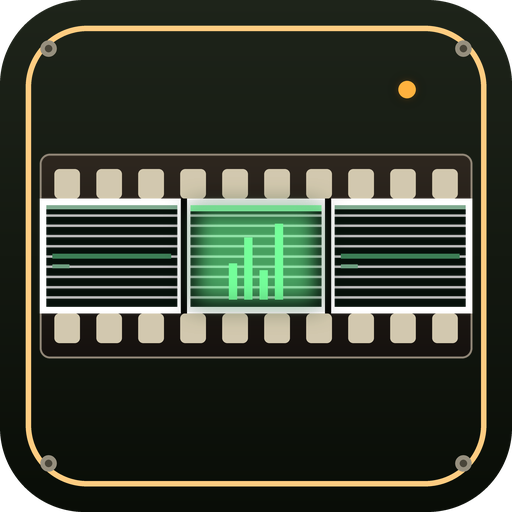
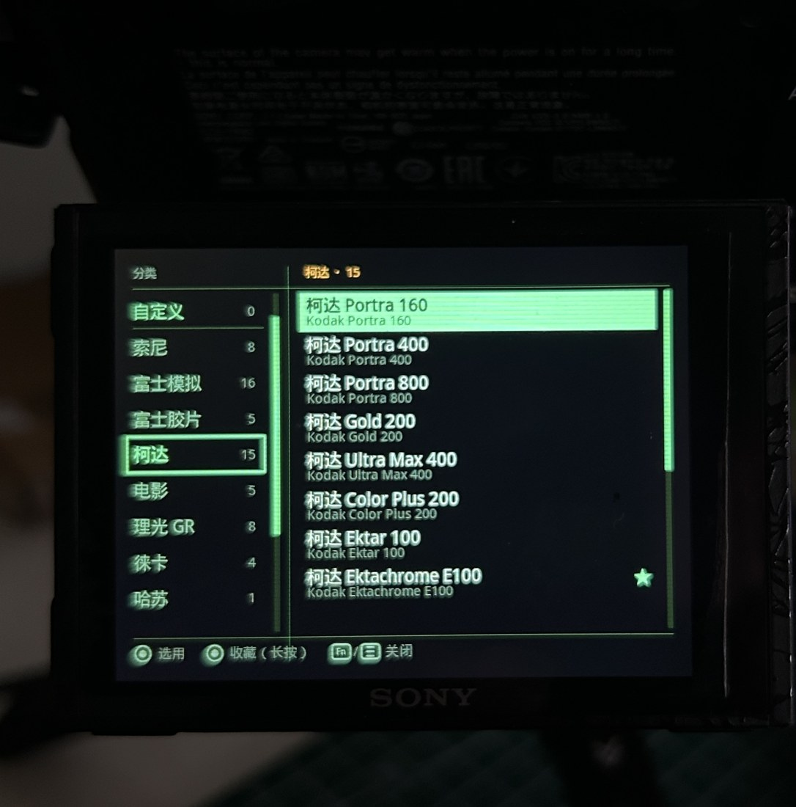
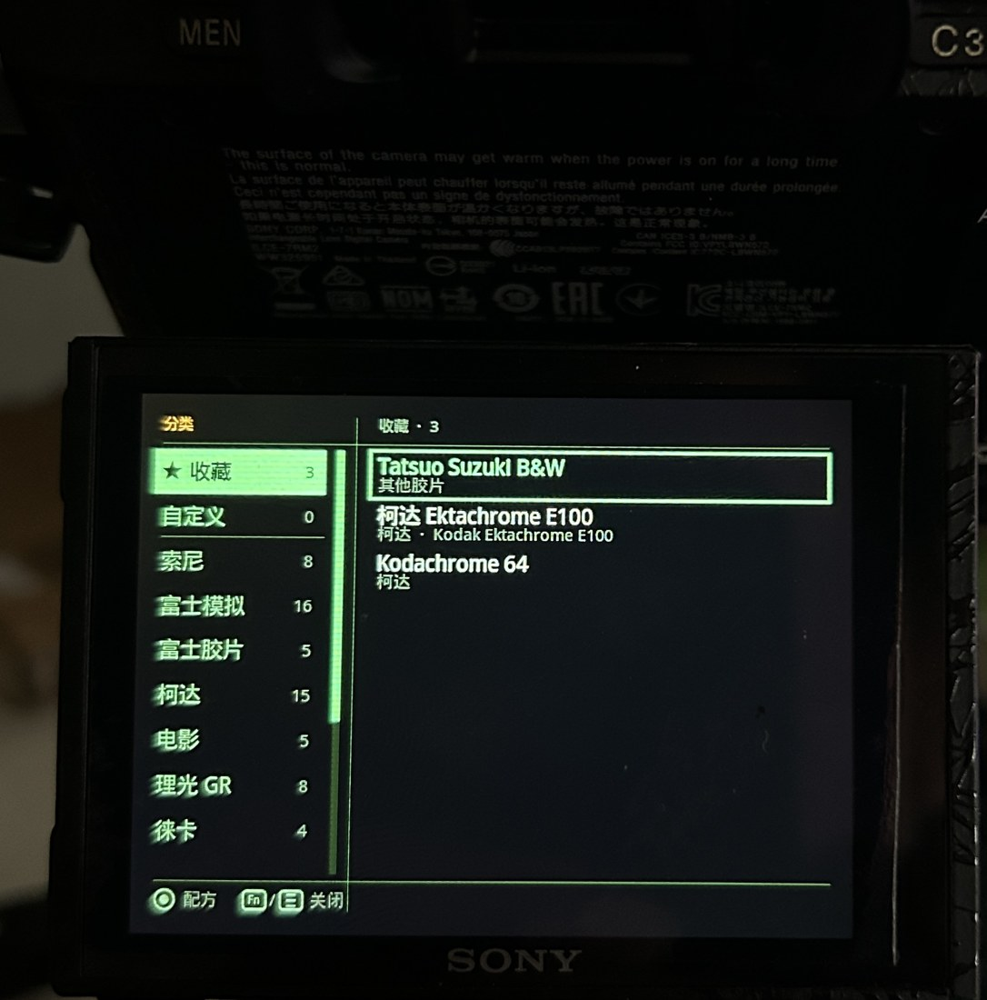
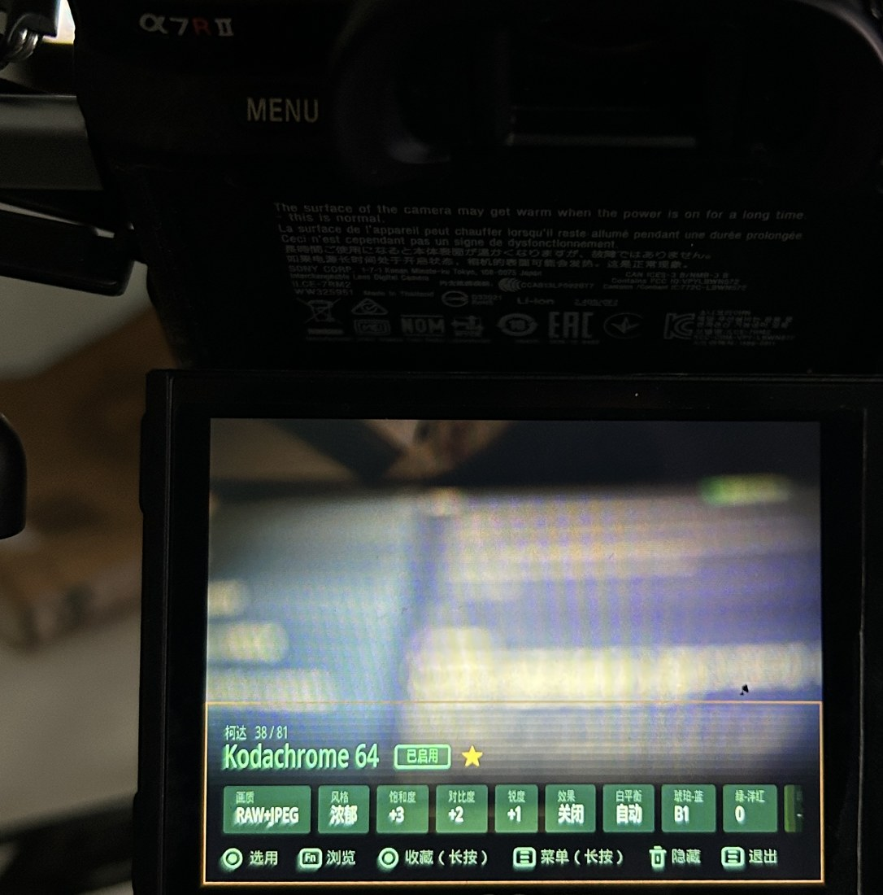

<p align="center">
  
</p>

<h1 align="center">Recipe Lab · 中文主题美化版</h1>

<p align="center">
  <b>卡带未来主义（Cassette Futurism）</b>界面 · 直接跑在索尼相机上的胶片配方应用<br>
  <sub>81 种配方 · 实时预览 · 一键写入相机 · 完整六语（英 / 简 / 繁 / 日 / 韩 / 越）</sub><br>
  <sub>基于 <a href="https://github.com/voxivoid/recipe-lab-sony-pmca">voxivoid/recipe-lab-sony-pmca</a> 最新代码（GPL-3.0）· 非官方分支</sub>
</p>

> **配套的电脑端工具：[Recipe Lab Studio](https://github.com/jjingith/recipe-lab-studio-sony-pmca)**
> 在电脑上做配方，不用再在相机上一条条捏。它能把 `.cube` 文件、一组摄影作品，或「原片 + 成片」两张同机位照片
> 拟合出风格相近的**自定义配方**，实时预览套用效果与残差，存进 PC 主库，再一键推送到相机存储卡的
> `RECIPES\` 文件夹（写前备份 + 写后回读校验）。界面同样简 / 繁 / 英三语，**永久免费**。
> 注意：它写入的是**自定义配方**，需要相机上装的是**含自定义配方功能**的版本（本分支或上游原版）；没有这个入口的旧版读不到。

---

**目录**

- [声明](#声明)
- [这是什么](#这是什么)
- [本分支做了什么](#本分支做了什么)
- [实机截图](#实机截图)
- [新增的滤镜](#新增的滤镜)
- [支持机型](#支持机型)
- [下载与安装](#下载与安装)
- [操作速查](#操作速查)
- [从源码构建](#从源码构建)
- [与上游原版的差别](#与上游原版的差别)
- [已知限制](#已知限制)
- [致谢](#致谢)
- [许可](#许可)
- [打赏](#打赏)

---

## 声明

- **本仓库 [jjingith/recipe-lab-sony-pmca-cn](https://github.com/jjingith/recipe-lab-sony-pmca-cn) 是本分支唯一的原创与维护仓库。** 卡带未来主义主题、六语界面、81 种配方与全部构建脚本都在这里维护，后续更新只在此发布。
- **本分支基于 [voxivoid/recipe-lab-sony-pmca](https://github.com/voxivoid/recipe-lab-sony-pmca)（GPL-3.0）汉化与二次开发**，上游作者与贡献者的版权与署名完整保留，见[致谢](#致谢)与[许可](#许可)。上游在 v1.7.0（含）之前以 MIT 发布，自 v1.8.0 起改为 GPL-3.0 并附带 GPL 7(b) 署名条款。
- **欢迎 fork、修改与再分发**（GPL-3.0 允许），但请保留本仓库链接、上游署名与版权声明：不要移除 GitHub 上的 `forked from` 标识，也不要把自己的副本描述成「原创」并抹去来源。
- **未经修改的同名副本只是镜像。** 正式版本与 Releases 只在本仓库发布；其他账号下不保留署名的同名仓库与本人无关，也不代表本人的后续更新与技术支持。
- **项目永久免费，并以 GPL-3.0 开源**：任何人都可以按 GPL-3.0 自由使用、修改与再分发（GPL 亦允许有偿分发）。本人自己不提供收费版、解锁版或付费授权渠道；除本 README 末尾的[打赏](#打赏)入口外，不对本项目收取任何费用。

---

## 这是什么

一个直接运行在**索尼 PlayMemories 相机应用（PMCA）**上的应用。滚动拨轮浏览 **81 种胶片配方**（富士、柯达、徕卡、哈苏、理光 GR、电影胶片、伊尔福德等色彩风格），画面实时预览变化，按下中央按钮即把该风格**永久写入相机设置**——之后在 P/A/S/M、照片和视频所有模式下都持续生效，关机重启也不会丢失。

- **不碰固件、不越狱**：只写入你本来也能在相机菜单里手动修改的设置项
- **完全可逆**：应用内按 TRASH 键即可恢复出厂色彩
- **实时预览**：拨动拨轮即可看到画面变化，满意了再写入
- **六语界面**：English / 简体中文 / 繁體中文 / 日本語 / 한국어 / Tiếng Việt，可在应用菜单里切换，`Auto` 会跟随相机语言

## 本分支做了什么

| 项目 | 说明 |
| --- | --- |
| **界面主题** | 整体改为**卡带未来主义（Cassette Futurism）**：黑底绿字显像管（荧光绿 `#74FF9A` / 琥珀 `#FFB23E`）、CRT 扫描线、方形硬件模块、标题旁指示灯、选中行反白（绿底黑字）；去掉了圆角、毛玻璃与渐变光晕；红色只用于警示 |
| **字体** | 英文改用**等宽终端字体** `Droid Sans Mono`，中文用 `Droid Sans Fallback`（均按需子集，Apache-2.0），两者行高都对齐相机自带字体，中英混排不再一大一小 |
| **图 标** | 换成卡带未来主义风格：**35mm 胶片**（齿孔 + 三格）内嵌**绿屏显像管**，炭灰机身、琥珀边框、四角螺丝、状态指示灯 |
| **额外滤镜** | 在原有 77 种配方之上**新增 4 种**胶片配方（见[下表](#新增的滤镜)），总数 **77 → 81** |
| **汉化** | 界面、菜单、弹窗、品牌浏览器、参数条、按键提示全部中文；创意风格与照片效果采用**索尼官方中文菜单用语** |

未翻译的仅有运行时传给相机 HAL 的参数键值（如 `standard`、`toy-camera`），这些是协议值，必须保持原样。

## 实机截图

以下为在 **A7R II（ILCE-7RM2）** 上实拍的本版界面。可见绿屏终端主题、等宽字体与完整中文渲染均正常。

| 品牌浏览器（柯达分组） | 配方列表（收藏标记） | 主面板 · 实时预览 |
| --- | --- | --- |
| [](docs/screenshots/01-brand-browser-kodak.jpg) | [](docs/screenshots/02-recipe-list.jpg) | [](docs/screenshots/03-panel-live-preview.jpg) |

- **左图**：品牌浏览器——左列为中文分组与配方数量（自定义 / 索尼 / 富士模拟 / 富士胶片 / 柯达 15 / 电影 / 理光 GR / 徕卡 / 哈苏…），右列为「柯达」组的配方，底部提示「选用 / 收藏(长按) / 关闭」
- **中图**：配方列表，`Kodak Portra 160` 起列，右侧星标为已收藏项
- **右图**：主面板实时预览 `Kodak Kodachrome 64`（38 / 81，徽章「已启用」），参数条 **画质 RAW+JPEG · 风格 浓郁 · 饱和度 +3 · 对比度 +2 · 锐度 +1 · 效果 关闭 · 白平衡 自动 · 琥珀·蓝 B1 · 绿·洋红 0**，底部「选用 / 浏览 / 收藏(长按) / 菜单(长按) / 隐藏 / 退出」

## 新增的滤镜

在官方 77 种配方基础上新增以下 4 种（参数基于对应胶片的光谱特性回归/实测校准）：

| 配方名 | 分组 | 取向 |
| --- | --- | --- |
| **Kodak 2383 print** | 电影 | Vision3 50D 负片 → 2383 印片的正片观感；青橙倾向克制，暗部偏冷 |
| **Kodak Aerocolor IV 2460** | 柯达 | 航空 C-41 卷：极干净、细颗粒、淡青底调、高光柔 |
| **Foma Pan 100** | 其他 | 经典黑白：细颗粒、深黑、层次干净 |
| **Tatsuo Suzuki B&W** | 其他 | 铃木达夫式粗粝街拍黑白：最大对比 +3、锐度 +1、−0.3 EV、关闭 DRO |

> 若你更喜欢相机原生的强反差黑白，可在「效果」里改用相机的 **强反差单色（HC）**。

## 支持机型

**已确认可用**：本分支在 **A7R II（ILCE-7RM2，固件 4.00 / 4.01）** 上实机验证。原项目支持的机型同样适用，包括 A7R / A7 II / A7 / A6000 / A6500 / A6300 / A5100 / NEX-5T / RX100 V / HX60 等（详见[上游说明](docs/UPSTREAM-README.md)）。

**不支持**：2016 年底之后发布的机型（A7 III 及以后、A9/A1 系列、A6x00 后续机型、ZV 系列、FX 系列、RX100 VA+、RX10 IV、RX0、HX99 等）——这些机型固件已加密，没有 `MENU → 应用程序` 入口，无法安装任何相机应用。

## 下载与安装

1. 到本仓库 **[Releases](../../releases)** 下载 `RecipeLab.apk`
2. 下载安装工具 **[Sony-PMCA-RE](https://github.com/ma1co/Sony-PMCA-RE/releases)**（Windows 用 `pmca-gui-v0.18-win.exe`）
3. 相机设置：`MENU → 设置 → USB 连接 → 大容量存储`，插好 SD 卡并开机
4. USB 连接电脑，运行 pmca-gui，点击 **Install app from file**，选择 `RecipeLab.apk`
5. 安装时相机黑屏 / 闪动属正常现象，**以电脑端 "Task completed successfully" 为准**，不要拔线
6. 拔线后**关机再开机**，然后 `MENU → 应用程序 → 应用程序列表 → Recipe Lab`

## 操作速查

| 按键 | 功能 |
| --- | --- |
| 控制拨轮 / 转盘 | 浏览配方（实时预览） |
| Fn | 打开品牌列表（第一项为收藏夹） |
| 中央按钮（短按） | **选定**当前配方，写入相机 |
| 中央按钮（长按） | 收藏 / 取消收藏 |
| AEL / DISP | 切换面板：完整 → 精简 → 隐藏 |
| TRASH | 恢复出厂色彩 |
| MENU | 退出应用 |
| C1 | 开发工具菜单（快照对比、只读检查、样片拍摄） |

> **关键**：选定配方后请关机再开机，该色彩风格才会在全部模式中默认生效。

## 从源码构建

需要：JDK（`javac --release 8` 可用）、Android SDK build-tools **30.0.3**、Android platform **android-28** 的 `android.jar`。

Windows 下本分支提供一键脚本（路径写在脚本里，按需修改）：

```cmd
build-local.cmd
```

即走完 `build.cmd` 的七步：`ndk-build → aapt → javac → d8 → aapt package → zipalign → apksigner`，产出 `RecipeLab.apk`。

**构建注意**：构建路径不要含中文（`aapt` 无法加载非 ASCII 路径下的 `android.jar`）；有 `assets` 时必须加 `-A assets`，否则内置字体不会被打包；签名用任意自签密钥即可（相机只校验 v1 / JAR 签名）。

改动了中文字表后需重建字体子集：

```
python3 tools/subset-font.py
```

## 与上游原版的差别

| | 上游原版 | 本分支 |
| --- | --- | --- |
| 包名 | `com.voxivoid.recipelab` | `com.lutlab.pmca` |
| 版本 | 1.9.0 | **1.9.0**（已跟进上游代码） |
| 配方数 | 77 | **81**（+4 滤镜） |
| 界面主题 | 原生深色 | **卡带未来主义绿屏** |
| 字体 | 系统字体 | **Droid Sans Mono / Droid Sans Fallback（内置）** |
| 语言 | 英 / 简 / 繁 / 日 / 韩 / 越 | **同上，并采用索尼官方中文菜单用语重新汉化** |

> 因为包名不同，本版可与原版**并存安装**，互不覆盖。

## 已知限制

- 配方是基于相机可存储参数对其他品牌色彩的**近似还原**，不是原厂色彩科学的复制
- 相机不存储色调曲线，因此对数曲线（S-Log、V-Log、CineLike D）与着色黑白（硒调、蓝晒）无法实现
- 设置槽位 ID 是在 A6000 上逆向得到的，在未经测试的机型上可能落在不同位置
- 照片效果类配方与 RAW 互斥（相机会忽略效果），应用会自动切换到 JPEG

## 致谢

- **[ma1co](https://github.com/ma1co)** —— PlayMemories 平台逆向工程（Sony-PMCA-RE、OpenMemories-Platform、OpenMemories-Tweak），没有这些工作本项目不可能存在
- **[voxivoid](https://github.com/voxivoid)** —— 原项目 Recipe Lab 的作者
- **AOSP Droid 字体** —— 内置 `Droid Sans Mono` 与 `Droid Sans Fallback` 子集（Apache-2.0），与相机字体同源

## 许可

- 本项目遵循上游，以 **GNU GPL-3.0** 授权，见 [LICENSE](LICENSE)。上游在 v1.7.0（含）之前以 MIT 发布，自 v1.8.0 起改为 GPL-3.0。
- 依上游 GPL-3.0 的附加条款 7(b)：任何副本或修改版本都必须在其源码声明中保留署名 **“Based on Recipe Lab by André Domingues”**；若带有交互式界面，还须在 Appropriate Legal Notices 中展示该署名。本分支遵守此条款。
- 内置字体为 Droid Sans Mono / Droid Sans Fallback 子集，**Apache License 2.0**，来源见 [assets/fonts/README.txt](assets/fonts/README.txt)
- 上游原版完整说明（英文）保留在 [docs/UPSTREAM-README.md](docs/UPSTREAM-README.md)

---

## 打赏

如果这个小项目让你的相机更好用了一点，欢迎到 [爱发电](https://afdian.com/a/jiajun2160) 请我喝咖啡 ☕。

打赏完全自愿，**不会获得额外功能或优先支持**——软件对所有用户一视同仁，永久免费。

谢谢！
